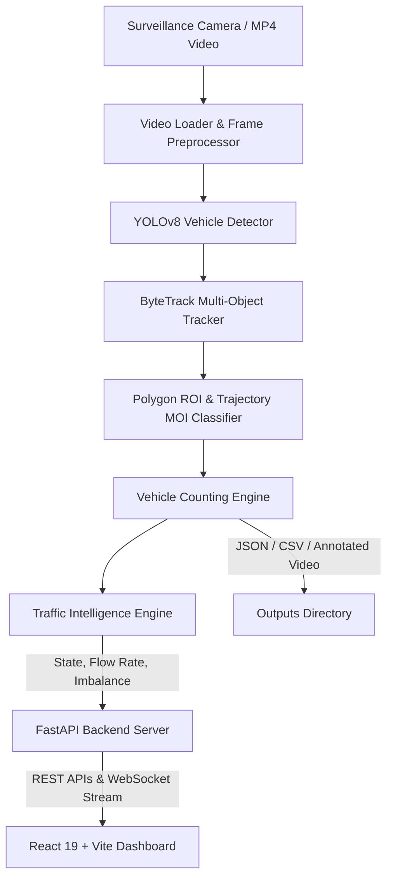

# TrafficTwin — Multi-Class Multi-Movement Vehicle Intelligence & Traffic Twin System

[](https://www.python.org/)
[](https://pytorch.org/)
[](https://github.com/ultralytics/ultralytics)
[](https://fastapi.tiangolo.com/)
[](https://react.dev/)
[](https://www.typescriptlang.org/)
[](https://vitejs.dev/)
[](https://www.aicitychallenge.org/)
[](https://opensource.org/licenses/MIT)

**TrafficTwin** is an end-to-end intelligent traffic perception and digital twin platform built for automated multi-class vehicle detection, multi-movement tracking, trajectory analysis, and real-time intersection congestion intelligence. Developed around the **AI City Challenge 2021 (AIC21) Track 1 Benchmark**, TrafficTwin turns surveillance video feeds into actionable smart-city telemetry, adaptive signal insights, and interactive dashboards.

---

## 📑 Table of Contents

- [Key Features](#-key-features)
- [System Architecture](#-system-architecture)
- [Project Structure](#-project-structure)
- [Dataset & Benchmark](#-dataset--benchmark)
- [Prerequisites](#-prerequisites)
- [Installation & Setup](#-installation--setup)
- [Running the System](#-running-the-system)
  - [1. Backend API (FastAPI)](#1-running-the-backend-api-fastapi)
  - [2. Frontend Web App (React + Vite)](#2-running-the-frontend-web-app-react--vite)
  - [3. CLI Offline Batch Pipeline](#3-running-the-offline-batch-inference-cli)
- [API Documentation](#-api-documentation)
- [Web Interface Pages](#-web-interface-pages)
- [Configuration Guide](#-configuration-guide)
- [Evaluation & Performance](#-evaluation--performance)
- [License & Acknowledgments](#-license--acknowledgments)

---

## 🚀 Key Features

### 1. Computer Vision & Multi-Class Tracking Pipeline
- **Object Detection**: Lightweight, real-time vehicle detection using **YOLOv8n / YOLOv8s** running at 60+ FPS on GPU.
- **Multi-Class Support**: Discriminated detection and counting for Cars, Trucks, Buses, and non-counted vehicles (motorcycles/bicycles).
- **ByteTrack Multi-Object Tracking**: Association across frames with low-confidence matching to handle dense traffic and occlusion.
- **Polygon Region of Interest (ROI)**: Precise Shapely-based polygonal intersection filtering per camera angle.
- **Movement of Interest (MOI) Classification**: Trajectory angle and boundary-exit analysis to map vehicle movements (turns, through lanes, ramps).

### 2. Traffic Intelligence & Digital Twin Analytics
- **Dynamic Traffic State Classification**: Evaluates real-time flow rate (veh/min) into `LOW`, `MEDIUM`, `HIGH`, or `CRITICAL` states.
- **Direction Imbalance Detection**: Identifies bottleneck approaches and unequal traffic pressure across intersection legs.
- **Adaptive Signal Simulation**: Simulates dynamic green-light phase allocations based on live directional load vs. fixed-time signal cycles.

### 3. Modern Full-Stack Web Platform
- **Real-Time Live Analysis**: Streaming video overlays with detection bounding boxes, active tracking IDs, and ROI overlays.
- **Interactive Simulator**: Dynamic sandbox to experiment with arrival rates, turning splits, and signal timings.
- **Historical Telemetry**: Comprehensive Recharts graphs for flow trends, vehicle distributions, and hourly density.
- **Asynchronous Batch Processing**: Background queue for large video analysis jobs with real-time status polling.

---

## 🏛 System Architecture



---

## 📂 Project Structure

```plaintext
openhack/
├── AIC21_Track1_Vehicle_Counting/       # AI City Challenge 2021 Dataset & Metadata
│   ├── Dataset_A/                      # Surveillance video files (.mp4)
│   ├── ROIs/                           # 20 Camera Region-of-Interest polygons
│   ├── movement_description/           # MOI turning and lane definitions
│   ├── counting_gt_sample/             # Ground truth CSVs & sample annotations
│   └── screen_shot_with_roi_and_movement/ # Visual ROI/MOI reference screenshots
├── traffic_ml/                         # Core Machine Learning & Web Application
│   ├── api/                            # FastAPI Server & Pydantic Data Models
│   │   ├── server.py                   # REST endpoints & streaming services
│   │   └── models.py                   # Request/Response data schemas
│   ├── configs/                        # System Configurations
│   │   └── config.yaml                 # Master pipeline and model parameters
│   ├── src/                            # Pipeline Source Code
│   │   ├── detection/                  # YOLOv8 Detector wrappers
│   │   ├── tracking/                   # ByteTrack tracking integration
│   │   ├── counting/                   # ROI boundary counting logic
│   │   ├── movement/                   # MOI trajectory & angle analysis
│   │   ├── analytics/                  # Traffic state, flow rate & imbalance
│   │   ├── inference/                  # End-to-end unified execution pipeline
│   │   └── evaluation/                 # MAE, RMSE, and accuracy benchmarking
│   ├── web/                            # React 19 + TypeScript Frontend (Vite)
│   │   ├── src/
│   │   │   ├── components/             # Reusable UI cards, tables & badges
│   │   │   ├── pages/                  # Overview, LiveAnalysis, Simulator, History
│   │   │   ├── services/               # Axios API client & WebSocket adapters
│   │   │   └── types/                  # TypeScript interface definitions
│   │   ├── package.json
│   │   └── vite.config.ts
│   ├── outputs/                        # Generated videos, metrics, and JSON results
│   ├── reports/                        # Progress logs & error analysis reports
│   ├── scripts/                        # Dataset inspection & utility tools
│   ├── main.py                         # Single-command CLI inference entrypoint
│   └── requirements.txt                # Python backend dependencies
└── README.md                           # Project documentation
```

---

## 📊 Dataset & Benchmark

The system is calibrated on the **AI City Challenge 2021 Track 1 (Multi-Class Multi-Movement Vehicle Counting)** dataset:

- **Volume**: 31 surveillance video feeds across 20 distinct traffic cameras (5.35 GB, 185,446 frames, ~5 hours).
- **Environments**: Highway ramps, 4-leg signalized intersections (fisheye & standard), 3-leg allway stops, and single-approach roads.
- **Lighting & Weather**: Daytime normal, dawn/dusk, heavy rain, and snow.
- **Classes Counted**: Class 1: Cars (including Sedans, SUVs, Vans, Buses) | Class 2: Trucks (Freight & heavy transport).

---

## ⚙️ Prerequisites

- **Operating System**: Windows 10/11, Ubuntu 20.04+, or macOS
- **Python**: Python 3.10 or higher
- **Node.js**: Node.js v18.0+ and npm
- **GPU (Recommended)**: NVIDIA GPU with CUDA 11.8 / 12.1+ (4GB+ VRAM)

---

## 📦 Installation & Setup

### 1. Clone & Prepare Directory
```bash
git clone <repository-url>
cd openhack
```

### 2. Python Environment Setup
```bash
# Navigate to the ML project directory
cd traffic_ml

# Create and activate a virtual environment
python -m venv venv

# Windows (PowerShell / CMD)
.\venv\Scripts\activate
# Linux / macOS
source venv/bin/activate

# Install dependencies
pip install -r requirements.txt
```

### 3. Frontend Setup
```bash
# Navigate to the frontend directory
cd web

# Install npm packages
npm install
```

---

## 🚦 Running the System

### 1. Running the Backend API (FastAPI)
From the `traffic_ml/` directory:
```bash
python -m uvicorn api.server:app --host 127.0.0.1 --port 8000 --reload
```
- **Backend URL**: `http://127.0.0.1:8000`
- **Interactive Swagger Docs**: `http://127.0.0.1:8000/docs`
- **Health Check**: `http://127.0.0.1:8000/health`

### 2. Running the Frontend Web App (React + Vite)
From the `traffic_ml/web/` directory:
```bash
npm run dev
```
- **Web Dashboard**: `http://127.0.0.1:5173`

### 3. Running the Offline Batch Inference (CLI)
You can directly process any video feed and evaluate against Ground Truth using `main.py`:
```bash
cd traffic_ml

# Example: Run on cam_5 with Ground Truth evaluation (first 600 frames)
python main.py \
  --video "D:/openhack/AIC21_Track1_Vehicle_Counting/Dataset_A/cam_5.mp4" \
  --camera cam_5 \
  --gt "D:/openhack/AIC21_Track1_Vehicle_Counting/counting_gt_sample/counting_example_cam_5_1min.csv" \
  --max-frames 600

# Fast run (no video rendering output):
python main.py --video "D:/openhack/AIC21_Track1_Vehicle_Counting/Dataset_A/cam_5.mp4" --camera cam_5 --no-video
```

Output metrics and annotated videos are saved to:
- `traffic_ml/outputs/metrics/`
- `traffic_ml/outputs/videos/`

---

## 🌐 API Documentation

The FastAPI backend exposes the following primary endpoints:

| Method | Endpoint | Description |
|--------|----------|-------------|
| `GET` | `/health` | Server health check and GPU device status |
| `GET` | `/api/cameras` | List all 20 configured cameras with ROI & MOI details |
| `GET` | `/api/cameras/{cam_id}` | Detailed ROI vertices and movement list for a camera |
| `POST` | `/api/analyze` | Trigger synchronous or asynchronous video analysis |
| `GET` | `/api/jobs/{job_id}` | Check status and progress of an asynchronous processing job |
| `GET` | `/api/metrics/latest` | Retrieve latest vehicle counts and flow telemetry |
| `GET` | `/api/stream/{cam_id}` | MJPEG live video stream with real-time CV bounding boxes |
| `POST` | `/api/simulation/optimize` | Run adaptive signal timing optimization simulation |

---

## 🖥 Web Interface Pages

1. **Overview Dashboard**: High-level telemetry displaying total counted vehicles, active camera feeds, network-wide congestion breakdown, and peak flow hours.
2. **Live Analysis**: Real-time camera feeds with toggleable overlays (bounding boxes, track IDs, ROI polygon, MOI vectors), instant flow rate counters, and direction imbalance indicators.
3. **Traffic Simulator**: Digital twin simulation sandbox allowing operators to adjust arrival rates and test adaptive vs. static signal timing efficiency.
4. **History & Reports**: Detailed vehicle count logs, class distribution breakdowns (Car vs. Truck), exportable metrics (JSON/CSV), and ground truth comparison tables.

---

## 🛠 Configuration Guide

All key parameters are customizable in [`traffic_ml/configs/config.yaml`](file:///d:/openhack/traffic_ml/configs/config.yaml):

```yaml
detection:
  model: "yolov8n"             # YOLOv8 variant (yolov8n, yolov8s)
  confidence_threshold: 0.35   # Minimum detection confidence
  input_size: 640              # Input frame resolution

tracking:
  tracker: "bytetrack"         # Multi-object tracker
  track_buffer: 30             # Frame memory for occluded tracks
  match_thresh: 0.80           # IoU association threshold

intelligence:
  mechanism: "traffic_state_estimation"
  time_window_seconds: 60      # Rolling temporal window for flow calculation
  thresholds:
    low_flow_rate: 2.0         # veh/min
    medium_flow_rate: 8.0      # veh/min
    high_flow_rate: 15.0       # veh/min
    critical_flow_rate: 25.0   # veh/min
  direction_imbalance:
    imbalance_threshold: 3.0   # Flow ratio triggering directional congestion alert
```

---

## 📈 Evaluation & Performance

- **Inference Speed**: ~**61.7 FPS** on NVIDIA RTX 3050 Laptop GPU (1080p stream batching).
- **Memory Footprint**: Fits comfortably within 4.0 GB VRAM with PyTorch CUDA acceleration.
- **Ground Truth Evaluation**: Tested against AIC21 Track 1 sample ground truth (cam_5, 600 frames at 10 fps) validating exit detection, movement categorization, and traffic state progression from `LOW` to `CRITICAL`.

---

## 📄 License & Acknowledgments

This project is licensed under the **MIT License** — see the [LICENSE](file:///d:/openhack/LICENSE) file for details.

- Built using the **AI City Challenge 2021 Track 1 Dataset** for research and intelligent transportation benchmarking.
- Powered by [Ultralytics YOLOv8](https://github.com/ultralytics/ultralytics), [PyTorch](https://pytorch.org/), [FastAPI](https://fastapi.tiangolo.com/), and [React](https://react.dev/).
